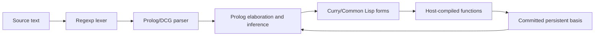

# SML

The `ooparts/sml` public package provides the lexer, parser, native semantic
terms, persistent Core and Module contexts, and compiled program execution. SML
source is not executed by an S-expression tree interpreter.



Syntax nodes use `(:node kind span ((slot . value) ...))`. Constructors,
logical type variables, and immutable object identities are represented as
native Prolog terms. The frontend and backend deliberately have no parallel
host-side typechecker or lowering model.

## Parsing and compiling

`parse-program` consumes an entire program and reports `sml-syntax-error` on
lexical, grammatical, or fixity errors. It accepts an immutable input
`:fixity-environment` and returns the resulting final fixity environment as a
second value. The default is strict SML '97. For an explicitly reviewed MLton
batch source, `:allow-omitted-final-semicolon t` instead permits a complete final
declaration or interactive expression at EOF without its final semicolon;
incomplete declarations are still errors. Source bytes are not rewritten.
EOF-consuming entry points also cover expressions, Core declarations, structure
expressions, signature expressions, and specifications.

`compile-source` accepts source text or a `source` object, with an optional
`:source-name` and persistent `:basis`. It returns an opaque `compiled-program`;
its static basis, semantic representation, and generated Curry function are
available through `compiled-static`, `compiled-semantic`, and `compiled-code`.
Compilation performs parsing, inference/elaboration, and code emission, but does
not evaluate SML declarations or expressions. Parsing, elaboration, semantic
compaction and module preparation share a private lexical production scope. Its
return carries the required emission/semantic images, frozen context and static
projection, final fixities, and a separate error span into native emission. The
original AST, query goals, answer wrappers and raw semantic roots end at that
boundary; no object reachable from a required product is cleared, including
literal payloads, source-descended data, nominal identities and mutable
references. The existing frontend collection request is repeated at this
post-production boundary on supported hosts. Source spans retain their source
text independently of redundant parser conses and already-closed query cursors.
After the complete semantic and static products are elaborated and frozen
together, native emission is scheduled in bounded rule/module parts. Rule bodies are generated before their matcher and
frame finishing in the established order. Module declarations finish in reverse
source order with ordinary declaration bodies and explicit continuation holes. Each part's ordinal
mapping restores the actual supplied argument cells and all of their references,
while the shared lexical tail is restored by identity. The outer emission query
receives the completed immutable product through the same scoped native-input
bridge used by item and rule queries, rather than embedding that product in VM
query templates. The bridge does not memoize or weakly retain semantic products.
This is a host-code materialization schedule, not a second semantic
representation or evaluator.

`run-program` host-compiles the generated function when necessary and evaluates
it. It returns the last interactive value and a new committed basis. Use the
returned basis for later compilation rather than trying to mutate the original:
`lookup-value`, `value-type`, `lookup-type`, and `value-to-string` inspect
committed bindings without exposing the implementation environment.

Recursive control can be emitted as native continuation steps over the same
Curry closures. `run-program` drives these steps with a trampoline; it does not
interpret the semantic AST. Higher-order primitives can still call the closures
directly for ordinary SML values, and compiled handler frames preserve SML
exception scope across the compiled computation.

Ordered rule matchers and bodies are independently host-compiled functions.
Only an explicit pattern non-match advances to the next rule. A successful
match, including one with zero binders, commits before its body runs, so a body
exception or handler re-raise cannot silently choose another clause. Static
rule code and capture-free metadata may be shared, but each activation has its
own lexical captures and explicit recursive value cells.

SBCL, CCL, ABCL, and ECL use host-supported weak-key tables for replaceable
compiled-function call-protocol metadata; other hosts retain a portable
ordinary EQ table. These implementation caches are not weak SML references,
logical type variables, immutable static/module views, or argument cells.
Required function values remain strongly owned by first-class bindings,
captured recursive/static values, or live continuations. They never depend on
the cached key for semantic lifetime or on global host function definitions.

```lisp
(let* ((old (ooparts/sml:make-initial-basis))
       (program
         (ooparts/sml:compile-source
          "val n = 42; val partial = fn y => n + y; n;"
          :basis old)))
  (multiple-value-bind (last-value basis)
      (ooparts/sml:run-program program :basis old)
    (assert (equal "42" (ooparts/sml:value-to-string last-value)))
    (multiple-value-bind (partial present-p)
        (ooparts/sml:lookup-value basis "partial")
      (assert present-p)
      ;; A compiled SML function is curried, including through old-binding lookup.
      (assert (= 50 (funcall partial 8))))))
```

## Runtime semantics

Matches create lexical binding frames; they do not copy record values. List and
user datatype values have explicit constructor identities distinct from their
spelling. Equality compares constructor and reference identity in the required
places and rejects inadmissible function or real equality. References retain
one mutable cell when environments or aliases are copied. Reference equality
compares the reference's identity for every referent type, including real and
function-valued contents; comparing those contents directly remains an equality
error.

An uncaught SML exception (`sml-raise`) prevents new static and dynamic bindings
from being committed. Reference mutations already performed before the
exception remain observable, as required by the language's evaluation and
state-update rules. Successful pattern matching and datatype aliases preserve
constructor identity; unrelated datatype or exception declarations do not.

A generated function is a Curry `lambda/c`. Mutual recursion uses lexical
recursive bindings, and old captured references are shared deliberately.
`compiled-code` is inspectable host-compilable code; `run-program` is the normal
execution interface and does not reinterpret the native semantic form on every
call.

## Primitive representation and shadowing

| Initial representation | Implementation policy |
|---|---|
| `int` | Exact host integers, without artificial 32-bit or 64-bit overflow behavior. |
| `word` | Unsigned values in $[0, 2^{32})$. `+`, `-`, and `*` wrap modulo $2^{32}$; `div` and `mod` operate on those canonical values and raise `Div` on zero divisors. |
| `real` | Host `double-float` values; direct real equality is not admitted. |
| `char` | The $N=256$ character alphabet, with the required ASCII agreement through 127. Valid ordinals are `0..255`. |

Word arithmetic wraps, but source Word literals must be representable: for
example, `0w4294967296` signals `sml-elaboration-error` with kind `:range`.
The overloaded `div` and `mod` accept the initial `int` and `word` types, while
unqualified `abs` and `~` accept only `int` and `real`. `chr` accepts ordinals
`0..255` and raises the user-visible `Chr` exception otherwise; literals use
the same character
range policy.

Internal literal/default type selection and derived forms use the original
primitive nominal types, not a same-spelled datatype in the current scope.
Ordinary annotations and aliases follow lexical shadowing. A datatype named
`bool` does not thereby allow its constructors in an `if` test, but its own
declarations and pattern matches still work normally.

## Modules, signatures, and functors

Structure values are immutable, namespace-tagged field views. Value, type,
structure, signature, and functor lookup remain distinct even when spellings
coincide. Structure aliases and ascriptions share their underlying field
values, including mutable reference cells; `open` imports proper structure
components rather than a same-spelled outer value or type.

Signatures preserve which type names and constructors are bound by the
signature. Each occurrence of a named signature instantiates those bindings
independently. Matching can realize an abstract bound type, but a rigid type in
the enclosing basis must retain its nominal identity. Type schemes and
constructor identities are not rewritten merely because an actual structure
has a compatible spelling.

`sharing type` canonicalizes all participating paths and propagates any
required equality attribute independently of declaration order. `where type`
requires a signature-bound target, an arity-compatible outer-basis type
expression, and adequate equality. Opaque ascription refreshes the expected
abstract names and exports the corresponding schemes with the signature's
arity and equality attributes. Explicit type functions and datatype
replications retain their identities; opaque sealing does not redraw actual
constructor declarations merely because they were generated.

Functor bodies become Curry-backed lexical functions. Application instantiates
declared datatype and exception identities afresh while preserving captured
values, argument aliases, and references. Failed elaboration evaluates no SML;
an uncaught `sml-raise` leaves the previous bindings uncommitted while retaining
mutations that already occurred.

## Structured Basis primitives

The initial Basis also exposes immutable module views for a set of structured
primitives. These use the same qualified lookup and typechecking rules as
user structures, and their function fields are Curry-backed values rather than
interpreted source expressions.

- `Int.int` is the ordinary `int` type, and `Int.toString` produces decimal
  text with SML's `~` negative sign.
- `Bool.bool`, `Bool.toString`, and `Bool.not` provide the primitive Boolean
  type and operations.
- `String.string`, `String.concat`, `String.size`, `String.explode`, and
  `String.implode` provide the corresponding string operations. Unqualified
  `concat : string list -> string` is also available.
- `TextIO.print` writes to the current standard-output destination. Stream and
  file I/O are separately assessed prerequisites; this declaration does not
  claim the full `TextIO` interface.
- `List.map`, `List.length`, `List.foldl`, and `List.foldr` are polymorphic,
  curried operations. Higher-order calls preserve SML pair arguments and the
  required left/right folding orders.

The primitive type aliases retain their original nominal identities. Full
Standard Basis coverage, including arrays, vectors, formatted input/output and
fixed-width numeric structures, is a separate facility requirement rather than
an implicit claim of SML '97 Core or Modules support.

## Tests and optional corpus verification

Run the native component suite with:

```sh
sbcl --script tools/test.lisp sml
```

It is also included in `ooparts-tests` and the existing aggregate Nix checks.
The ordinary component does not download an external SML implementation or
regression corpus.

The separate [MLton conformance tool](conformance.md) is opt-in. Its ignored,
pinned corpus is HPND-licensed with component notices, not MIT-licensed or
redistributed as OOPArts source. Normal, module, and expected-rejection cases
are distinguished; `.nonterm` is compile-only, `.ok` bytes are output
comparison data, and a missing `.ok` is not an empty-output expectation.
MLton-specific language extensions, target behavior, and rich Basis facilities
are reported in their own categories rather than relabeled as SML '97 Core or
silently counted as passes. Exact provenance and license-retention requirements
are in [the third-party register](../../THIRD_PARTY.md).
